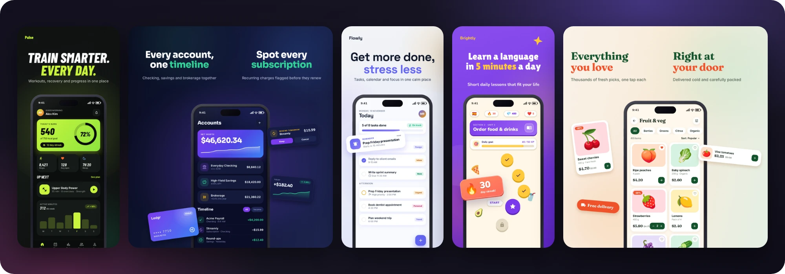
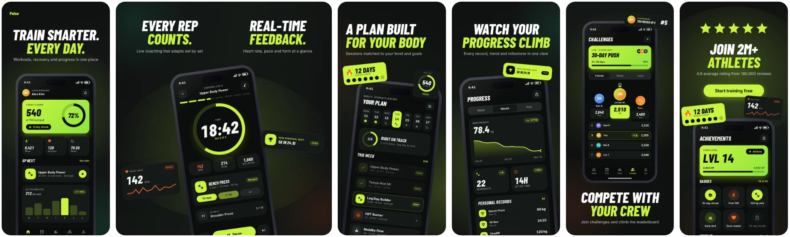
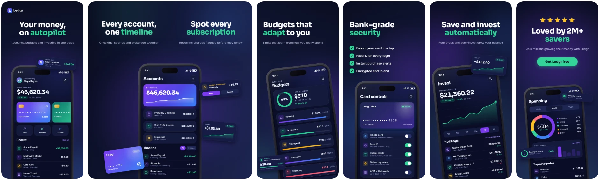
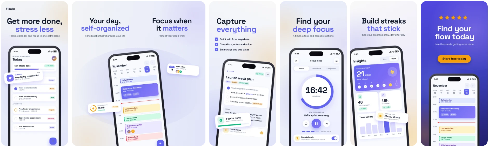
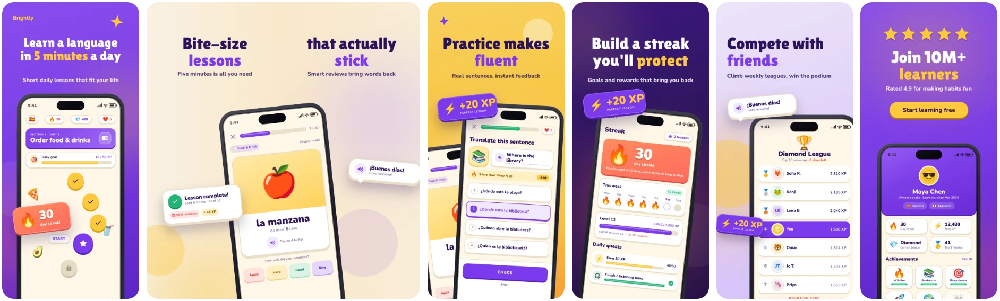
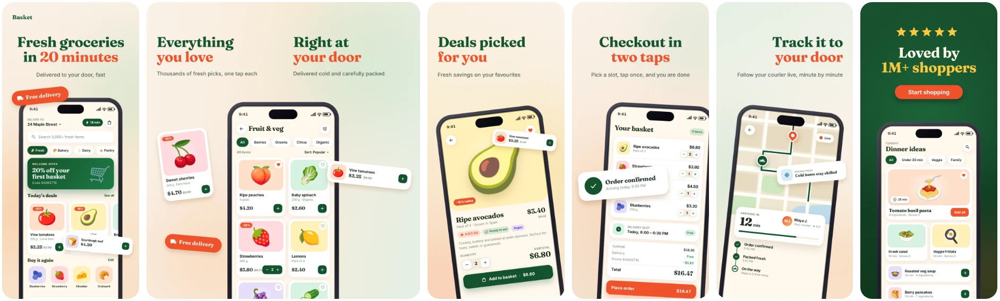
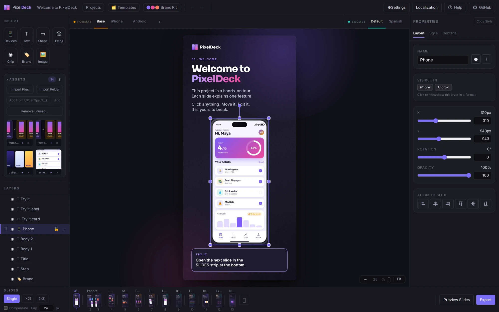
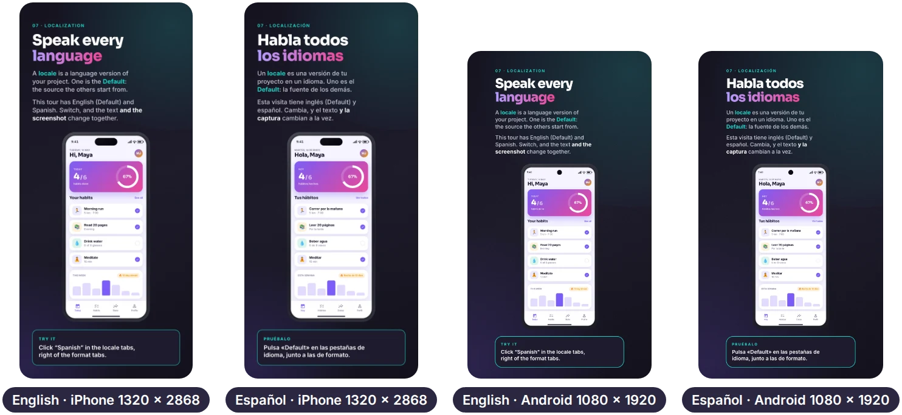
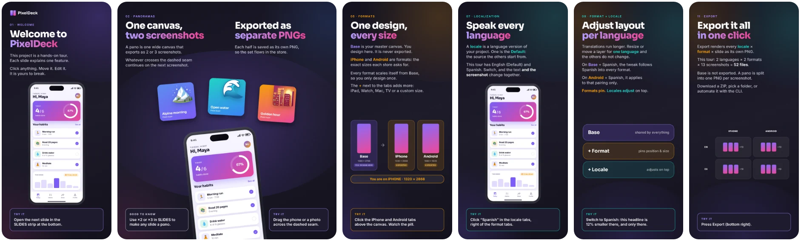

<p align="center">
  <a href="https://pr0xs.github.io/PixelDeck/" aria-label="Try PixelDeck in your browser">
    <picture>
      <source media="(prefers-color-scheme: dark)" srcset="public/logo.svg" />
      
    </picture>
  </a>
</p>

<h1 align="center">PixelDeck</h1>

<p align="center">
  <b>Free, open-source App Store &amp; Play Store screenshot generator.</b><br />
  Pick a template, drop in your screenshots, export every size and language.<br />
  Runs in your browser: no account, no subscription, nothing to install.
</p>

<p align="center">
  <a href="https://pr0xs.github.io/PixelDeck/"></a>
</p>

<p align="center">
  <a href="https://github.com/Pr0xS/PixelDeck/stargazers"></a>
  <a href="LICENSE"></a>
  <a href="https://github.com/Pr0xS/PixelDeck/actions"></a>
  <a href="CONTRIBUTING.md"></a>
  <a href="AGENTS.md"></a>
</p>

<p align="center">
  <a href="https://pr0xs.github.io/PixelDeck/">
    
  </a>
</p>

<p align="center"><sub>Every screenshot above was made with PixelDeck. All five sets ship in the app as editable templates.</sub></p>

---

## What you can make

PixelDeck is a layer-based canvas editor built for one job: store screenshots that look designed. Device mockups, headlines, gradients, floating cards and panoramas that run across two or three screenshots.

The gallery ships five complete templates. Use one as a new project, swap in your own screenshots and change the copy and colours.

<details>
<summary><b>See the five templates</b> · Health &amp; Fitness, Finance, Productivity, Education, Shopping &amp; Food</summary>

**Pulse** · Health &amp; Fitness



**Ledgr** · Finance



**Flowly** · Productivity



**Brightly** · Education



**Basket** · Shopping &amp; Food



</details>

---

## How it works

1. **Start from a template**, or from the Welcome tour that opens the first time you launch the app.
2. **Drop your screenshots onto the phones**, then edit text, colours and layout directly on the canvas.
3. **Export** every format and language as PNG: a ZIP or folder from the browser, or the CLI for automation.

<p align="center">
  <a href="https://pr0xs.github.io/PixelDeck/">
    
  </a>
</p>

### One design, every size and language

Design once on the **Base** canvas. Each store format (iPhone, Android, iPad, Watch, Mac and more) scales itself from Base, and you can fine-tune any of them without touching the others. Add a language and the text, the screenshots inside the phones and even the layout can change per locale.



### Learn it in five minutes

The first launch opens a hands-on tour: one feature per slide, with real layers you can click, move and break. Formats and localization are live demos, not descriptions.



---

## Why PixelDeck?

- 🖼️ **Panoramas** — one wide canvas that exports as 2 or 3 screenshots, so a device or an image can cross the seam between them.
- 🎨 **A real layer system** — devices, rich text, images, shapes, emoji, brand lockups and groups. Everything can be moved, resized, rotated and restyled.
- 📱 **Every store size from one design** — formats scale from a shared Base canvas, with per-format adjustments when a size needs its own layout.
- 🌍 **Localization built in** — per-language text, screenshots and layout tweaks, a translation table, and optional AI translation with your own API key.
- 🤖 **Headless CLI** — batch-render every slide, format and locale to PNG with Playwright, ready for CI.
- 🔒 **Local-first** — no account, no backend, no telemetry. Projects are saved in your browser and never leave your machine.
- 🆓 **Free and MIT-licensed** — fork it, extend it, self-host it.

### Who is it for?

- **Indie iOS and Android developers** who want professional screenshots without a design-tool subscription.
- **Mobile teams** that need repeatable, version-controlled screenshots in CI: one design, every locale, every device size.
- **ASO and marketing** people who want full creative control over store visuals.

---

## Features

<details>
<summary><b>Visual editing</b></summary>

| | |
|---|---|
| Canvas editor | Drag, resize, rotate and group layers; double-click to edit text on the canvas |
| Layer types | Background, device mockup, text, image, shape, emoji, brand lockup, group, plus chip badges |
| Layers panel | Drag to reorder or nest, toggle visibility, lock, rename |
| Properties | Context-aware panel with Layout / Style / Content tabs; copy and paste style between layers |
| Alignment | One-click align to the slide or to the selection |
| Device presets | Center / Hero / Bleed / Tilt positions for device mockups |
| Panoramas | Single, ×2 and ×3 slide groups with seam guides and optional store-gap compensation |

</details>

<details>
<summary><b>Typography, devices and effects</b></summary>

| | |
|---|---|
| Rich text | Colour, gradient, weight, italic, underline and strikethrough on any part of a text layer |
| RTL text | Auto / RTL / LTR paragraph direction, mixed Hebrew and Latin text, and grapheme-safe wrapping in editor and PNG export |
| Fonts | 76 curated Google Fonts, 10 system fonts, and your own uploaded fonts (.ttf, .otf, .woff2) |
| Gradients | Linear and radial fills on backgrounds, shapes and text, with quick-pick presets |
| Devices | iPhone 16 Pro, Pixel 9 (each with a clean status-bar variant), iPad, Android tablet, Apple Watch, Wear OS, frameless 16:9 and 16:10 screens |
| Status bar | Simulated iOS / Android status bar, transparent or solid |
| Backgrounds | Gradient or image, with glow accents, tint overlay, blur and noise texture |
| Effects | Per-layer drop shadow and blur |
| Brand Kit | Shared brand colours: change one and every layer using it updates |

</details>

<details>
<summary><b>Formats and localization</b></summary>

| | |
|---|---|
| Formats | Built-in store sizes for phone, tablet, watch, desktop, TV, VR and game stores, plus custom sizes |
| Per-format layout | Move or resize a layer on one format and the change stays on that format |
| Locales | Per-language text, phone screenshots and images |
| Per-language layout | Resize or move a layer for one language only, across every format or for one format |
| Localization view | One table with a row per text and a column per language |
| AI translation | Translate with your own key: OpenAI, OpenRouter, Google Gemini or any OpenAI-compatible endpoint |

</details>

<details>
<summary><b>Projects, templates and export</b></summary>

| | |
|---|---|
| Projects | Several projects with auto-save and undo/redo; export and import as a ZIP with images included |
| Welcome tour | Opens on first launch: one feature per slide |
| Templates | Five complete sets with demo screenshots; save your own layouts as templates |
| Assets | Import files or a folder, add from a URL, drag onto the canvas or drop from your desktop |
| Preview | Full-deck preview with a locale switcher |
| Browser export | Every locale × format × slide as PNG, as a ZIP or into a folder |
| CLI export | Headless batch rendering with Playwright: formats, locales and YAML batch configs |

</details>

### Export sizes

| Format | Size (px) |
|---|---|
| iPhone 6.9" | 1320 × 2868 |
| Android phone | 1080 × 1920 |
| iPad 13" | 2064 × 2752 |
| iPad 11" | 1668 × 2420 |
| Android tablet 10" | 1600 × 2560 |
| Apple Watch | 422 × 514 |
| Wear OS | 480 × 480 |
| Mac | 2880 × 1800 |
| Apple TV / Vision Pro | 3840 × 2160 |
| Steam | 1920 × 1080 |
| Meta Quest | 2560 × 1440 |
| Custom | Any size you define |

Each format is exported at exactly these pixel dimensions.

---

## Quick start

The fastest way to try PixelDeck is the **[hosted app](https://pr0xs.github.io/PixelDeck/)**: nothing to install.

### Run locally

> Requires Node.js 20.19+.

```bash
npm install
npm run dev
```

Open <http://localhost:5173>.

### CLI batch export

Build the web app first, since the CLI renders from `dist/`:

```bash
npm run build
npx playwright install chromium   # one-time
node cli/index.mjs export \
  --project=./projects/my-app.zip \
  --output=./output/store
```

`--project` takes a project exported from the app (ZIP or JSON). The CLI exports the project's active formats by default; use `--format=iphone-69 --format=ipad-13` to pick formats and `--all-locales` to export every language. See [`cli/README.md`](cli/README.md) for locale export, the screenshots folder and YAML batch configuration.

---

## FAQ

**Is PixelDeck free?**
Yes, completely. MIT-licensed, no paid tier, no limits.

**Do I need an account?**
No. The editor runs entirely in your browser. The hosted app needs a connection to load itself, Google Fonts and the templates.

**Is my data private?**
Yes. There is no backend and no telemetry. Projects are saved in your browser (`localStorage`, with images in IndexedDB) and stay on your machine unless you export them.

**Does it work for Google Play?**
Yes. Android phone and tablet formats and Pixel device mockups are built in, next to the Apple ones.

**Can I export several languages?**
Yes. Add locales, translate in the Localization view (by hand or with AI), and the export produces every language in one go.

**How does AI translation handle my API key?**
The key is stored only in your browser and requests go straight from your browser to the provider you chose.

**Can I use it in CI, with fastlane or GitHub Actions?**
Yes. The headless CLI (`node cli/index.mjs export`) renders PNGs with Playwright and fits into any pipeline.

**Can I self-host it?**
Yes. Run `npm run build` and serve `dist/` from any static host.

---

## Under the hood

<details>
<summary><b>Tech stack</b></summary>

| Layer | Technology |
|---|---|
| UI framework | React 19 + TypeScript |
| Build tool | Vite 8 |
| Styling | Tailwind CSS v4 |
| Canvas rendering | Konva 10 / react-konva |
| State management | Zustand 5 + zundo (undo/redo) |
| Drag & drop | dnd-kit |
| Headless export | Playwright (Chromium) |

</details>

<details>
<summary><b>Project structure</b></summary>

```text
pixeldeck/
├── cli/       # Headless Playwright export CLI and batch config examples
├── docs/      # In-app help chapters (docs/help) and README media (docs/media)
├── public/    # Static assets and the generated gallery templates (public/templates/)
├── scripts/   # Template toolchain: sources, build, lint, previews, README images
└── src/       # React app, Zustand stores, Konva canvas, domain types, utilities
```

See [`ARCHITECTURE.md`](ARCHITECTURE.md) for the system design, data model and export pipeline.

</details>

### For AI agents

PixelDeck is designed to be extended by AI coding agents. [`AGENTS.md`](AGENTS.md) maps every file, gives the recipe for adding a layer type, documents non-obvious behaviours and defines a verification contract. Agent contributions are welcome; see [`CONTRIBUTING.md`](CONTRIBUTING.md).

---

## Contributing

Bug reports, feature ideas, docs improvements and pull requests are welcome. Please read [`CONTRIBUTING.md`](CONTRIBUTING.md) before opening a PR.

⭐ If PixelDeck is useful to you, star the repo: it helps other developers find it.

## License

PixelDeck is released under the [MIT License](LICENSE).
